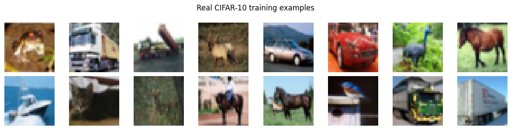
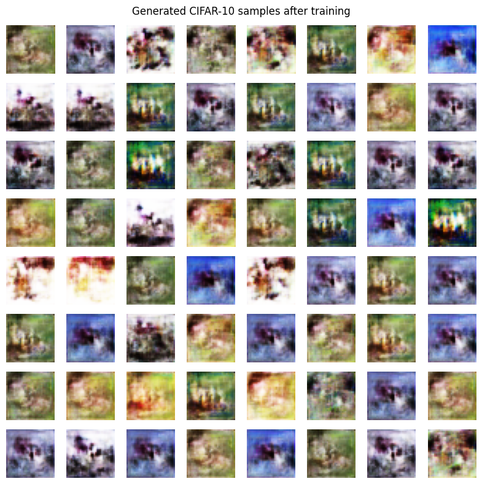
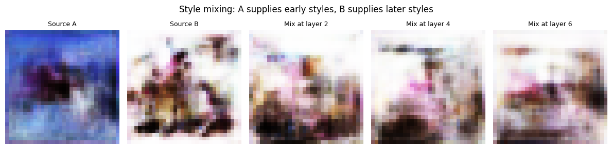
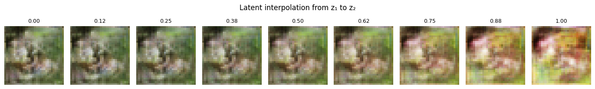
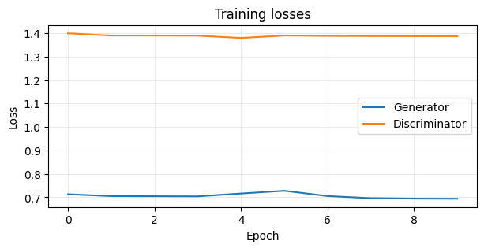

# 🎨 StyleGAN for CIFAR-10 in TensorFlow


**Author:** Parisathulasidoss (E0324046)
**Project:** From-scratch, compact implementation of a StyleGAN-inspired generator (Karras et al.) in TensorFlow/Keras, trained on color CIFAR-10 (32 × 32 RGB).

---

## 📌 Architectural Overview

The generator decouples image synthesis from the random latent input: a mapping network turns `z` into an intermediate style vector `w`, and every synthesis layer is modulated by that style.

```
Latent z (128) ─► 8-Layer Mapping MLP ─► Intermediate Style w (128)
                                                │  (fed to every layer via AdaIN)
                                                ▼
Learned Constant (4×4×128) ─► StyledConv ×2 (4×4)
                           ─► Upsample ─► StyledConv ×2 (8×8)
                           ─► Upsample ─► StyledConv ×2 (16×16)
                           ─► Upsample ─► StyledConv ×2 (32×32) ─► 1×1 Conv + tanh ─► RGB image
```

Each `StyledConv` = `3×3 Conv → + noise → AdaIN(w) → LeakyReLU`.

The discriminator is a 4-block strided convolutional network (32 → 64 → 128 → 128 channels) followed by a dense logit layer.

## 🔑 Key Components Implemented

1. **Mapping Network** (`f: Z → W`): 8 dense layers with input pixel-normalisation and LeakyReLU map a Gaussian latent `z ∈ R^128` to the style space `w ∈ R^128`.
2. **Adaptive Instance Normalization (AdaIN)**: each feature map is normalised, then scaled and shifted by a per-channel affine transform of `w`.
   `AdaIN(x, w) = norm(x) · (1 + y_s(w)) + y_b(w)`
3. **Learned Constant Input**: synthesis starts from a trainable `4×4×128` tensor instead of a sampled noise vector.
4. **Stochastic Noise Injection**: per-pixel Gaussian noise, multiplied by a learned per-layer strength, is added after every convolution to model fine texture detail.
5. **Style Mixing**: different style vectors can be fed to early and late layers at inference time to show which layers control coarse vs. fine appearance.
6. **Non-saturating Logistic GAN Loss**: discriminator minimises `softplus(-D(x)) + softplus(D(G(z)))`; generator minimises `softplus(-D(G(z)))`.

## 📁 Repository Structure

```
StyleGAN-CIFAR10/
├── models/
│   ├── __init__.py
│   ├── mapping.py          # 8-layer MLP mapping network (z -> w)
│   ├── adain.py            # Adaptive Instance Normalization
│   ├── blocks.py           # StyledConv (conv + noise + AdaIN)
│   ├── generator.py        # StyleGenerator synthesis network
│   └── discriminator.py    # Convolutional discriminator
├── data/
│   └── dataset.py          # CIFAR-10 loading and tf.data pipeline
├── utils/
│   └── visualize.py        # Sample grids, loss curves, style mixing, interpolation
├── outputs/                # Generated figures
├── checkpoints/            # Saved weights (created by train.py, not tracked by git)
├── config.py               # Shared hyper-parameters
├── train.py                # Adversarial training script
├── generate.py             # Generate figures from saved weights
├── StyleGAN_CIFAR10_TensorFlow.ipynb   # Notebook with code and execution outputs
├── requirements.txt        # Dependencies
├── LICENSE
└── README.md
```

## 📊 Output Visualizations

### 1. Real CIFAR-10 training examples


### 2. Generated samples (64 fixed latent vectors, after 10 epochs)


### 3. Style mixing
Source A supplies the early-layer styles and source B supplies the later-layer styles at different cut-off layers.


### 4. Latent interpolation
Linear interpolation between two latent vectors `z₁ → z₂` (9 steps).


## 📈 Training Loss Log (10 Epochs)

| Epoch | Discriminator Loss (L_D) | Generator Loss (L_G) |
|:-----:|:------------------------:|:--------------------:|
| 1/10 | `1.399` | `0.713` |
| 2/10 | `1.389` | `0.705` |
| 3/10 | `1.389` | `0.704` |
| 4/10 | `1.389` | `0.704` |
| 5/10 | `1.379` | `0.716` |
| 6/10 | `1.389` | `0.728` |
| 7/10 | `1.388` | `0.705` |
| 8/10 | `1.387` | `0.696` |
| 9/10 | `1.387` | `0.694` |
| 10/10 | `1.387` | `0.694` |



**Setup:** 20,000 CIFAR-10 images, batch size 64, Adam (lr 2e-4, β₁ = 0, β₂ = 0.99), seed 42, CPU run of about 25 minutes. Generator: 1,044,651 parameters; discriminator: 428,385 parameters.

### Observations

- The losses stay near D ≈ 1.387 (≈ 2·ln 2) and G ≈ 0.694 (≈ ln 2) from epoch 2 onward. That is the value reached when the discriminator outputs about 0.5 for every input, so the discriminator is not yet separating real from fake images.
- Samples show colour and texture patterns but not recognizable objects, and many samples look alike (low diversity).
- The style-mixing and interpolation code works, but the differences are subtle because sample diversity is low.
- This is a compact teaching implementation, not a reproduction of original StyleGAN quality.

### Possible improvements
Train longer on a GPU with all 50,000 images, add minibatch standard deviation and R1 gradient penalty, use an EMA of generator weights, equalised learning rate, and evaluate with FID.

## ⚡ Quick Start & Usage

### 1. Installation
```bash
git clone https://github.com/Parisathulasidoss/E0324046-Style-GAN.git
cd E0324046-Style-GAN
pip install -r requirements.txt
```

### 2. Train the model
```bash
python train.py                      # defaults from config.py
python train.py --epochs 30 --limit 50000   # longer run, full dataset
python train.py --synthetic --epochs 1 --limit 256   # quick smoke test, no download
```
This saves weights to `checkpoints/` and figures to `outputs/`.

### 3. Generate figures from saved weights
```bash
python generate.py --checkpoint checkpoints/generator.weights.h5 --out_dir outputs
```

### 4. Or use the notebook
```bash
jupyter notebook StyleGAN_CIFAR10_TensorFlow.ipynb
```

## 📜 Citation & Acknowledgments

- Karras, T., Laine, S., & Aila, T. (2019). *A Style-Based Generator Architecture for Generative Adversarial Networks.* IEEE/CVF Conference on Computer Vision and Pattern Recognition (CVPR).
- Krizhevsky, A. (2009). *Learning Multiple Layers of Features from Tiny Images* (CIFAR-10 dataset).
- TensorFlow / Keras teams for the framework and dataset loader.
